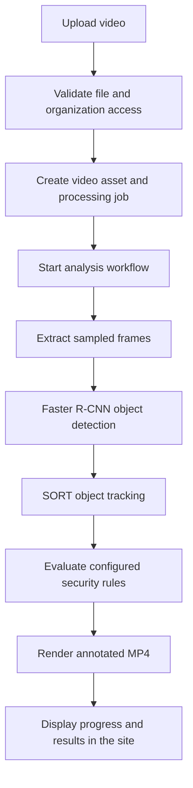

# AEGISVISION

**AI-Assisted Video Analytics & Security Operations Platform**

[](https://github.com/AliSolhjoo/AEGISVISION/actions/workflows/ci.yml) · [](#license)

AEGISVISION is a Django and React application for organization-aware camera management, recorded-video analysis, object detection and tracking, rule-based security-event detection, live RTSP/RTSPS camera intelligence, and Security Operations Center (SOC) workflows. The user interface supports Persian and English with RTL/LTR layouts.

> **Current project package:** `1.5.0` — Live Camera Intelligence  
> **Repository:** [AliSolhjoo/AEGISVISION](https://github.com/AliSolhjoo/AEGISVISION)  
> **Persian guide:** [`README_FA.md`](README_FA.md) · **GitHub upload guide (FA):** [`GITHUB_UPLOAD_FA.md`](GITHUB_UPLOAD_FA.md) · **Security policy:** [`SECURITY.md`](SECURITY.md)

---

## Contents

- [Overview](#overview)
- [Features](#features)
- [Analysis workflows](#analysis-workflows)
- [Architecture](#architecture)
- [Technology stack](#technology-stack)
- [Requirements](#requirements)
- [Installation](#installation)
- [Configuration](#configuration)
- [Running the application](#running-the-application)
- [First-use guide](#first-use-guide)
- [Frontend pages](#frontend-pages)
- [API overview](#api-overview)
- [Database and migrations](#database-and-migrations)
- [Testing and validation](#testing-and-validation)
- [Limitations and operational notes](#limitations-and-operational-notes)
- [Security](#security)
- [GitHub publication](#github-publication)
- [License](#license)

## Overview

AEGISVISION combines video-analysis tools with security-event operations in one organization-aware workspace. It has two main analysis paths:

1. **Recorded video:** upload a supported file, extract sampled frames, detect objects, track detections, evaluate configured event rules, and generate an annotated MP4 result.
2. **Network cameras:** register an RTSP/RTSPS source, test connectivity, and start server-side live analysis through a persistent worker manager.

The application also includes account authentication, organization membership and roles, camera/video inventories, detection and tracking history, event review, SOC dashboards, and bilingual interfaces.

This repository is a development codebase, not a turnkey production deployment. Review the configuration and security guidance before exposing it to the internet or connecting real cameras.

## Features

### Authentication and organization access

- Custom Django user model.
- Registration, sign-in, sign-out, JWT refresh, and current-user endpoints.
- Password change and password-reset request/confirmation flows.
- Organization workspaces, member management, and invitation acceptance.
- Organization roles currently defined in the backend: `owner`, `admin`, `operator`, `analyst`, and `viewer`.
- Organization-scoped access controls for cameras, videos, and security operations.

### Camera management

- Register and manage camera sources inside an organization.
- RTSP and RTSPS stream sources for server-side processing.
- Camera name, code, location, description, state, AI sampling FPS, and confidence threshold.
- Connection testing before starting live analysis.
- Camera usernames and passwords are submitted separately from the stream URL and encrypted before storage.
- Camera credential ciphertext is not returned by the normal camera API serializers.

The data model also has a `browser` source type, but browser-camera capture is not connected to the current server-side live-analysis worker.

### Recorded-video management and analysis

- Upload and manage video assets within an organization.
- Save file metadata such as original filename, file size, content type, and SHA-256 digest.
- Process videos and inspect job status.
- Browse extracted frames, detection results, tracking output, events, and generated annotated MP4s.
- Reprocess an existing asset through the API.

The upload workflow currently accepts `.mp4`, `.mov`, `.avi`, `.mkv`, `.webm`, and `.m4v` files. Code-level validation currently sets a 250 MB upload ceiling, a 20-minute maximum duration, and a maximum of 300 sampled frames. Confirm the limits in the current source before changing deployment limits.

### AI object detection

- Frame-level object detection using Faster R-CNN MobileNetV3 from the PyTorch/Torchvision stack.
- Detection results include a class label, confidence score, and bounding-box coordinates.
- Detection runs and frame results are persisted for later review.
- Annotated frame images are available through the API.

The first model execution may download pretrained model weights. GPU acceleration depends on a compatible PyTorch, Torchvision, CUDA runtime, and NVIDIA driver; otherwise, inference can run on CPU with lower throughput.

### Object tracking

- SORT-style multi-object tracking across sampled frames.
- Kalman-filter prediction for object bounding boxes.
- Hungarian assignment for frame-to-frame matching.
- Track records and observations are stored and available through API endpoints.
- Track information can be rendered into the exported video.

A track ID is a temporary identifier within a tracking run. It is not a verified real-world identity and does not provide cross-camera re-identification.

### Rule-based security events

The event engine supports rules including:

- **Zone intrusion:** detect an object entering a configured polygonal region.
- **Line crossing:** detect an object crossing a configured virtual line, with direction options.
- **Loitering:** detect an object remaining inside a region longer than a configured duration.

Rules can be associated with recorded videos or cameras. An example rule configuration is available at `backend/analytics_configs/example_rules.json`.

### Security Operations Center (SOC)

- SOC dashboard and event queue.
- Event severity and status management.
- Assignment to responsible users.
- Investigation notes and activity/audit history.
- CSV export of SOC events.
- Role-aware UI behavior and Persian/English localization.

### Live Camera Intelligence

- RTSP/RTSPS camera registration and connection testing.
- Encrypted camera credentials.
- Persistent background worker manager and worker heartbeat.
- Live object detection and SORT tracking on sampled frames.
- Annotated JPEG snapshots with boxes, classes, confidence values, and track IDs.
- Live zone-intrusion, line-crossing, and loitering rules.
- Live security events and event status updates.
- Connection state, frame counters, resolution, and processing-FPS information.
- Automatic reconnect attempts after temporary stream failures.

The current live-analysis configuration allows a `target_fps` from 1 to 10, with a model default of 2 FPS and default confidence threshold of 0.55. These are AI sampling settings, not the camera's native FPS or guaranteed browser playback rate.

### Bilingual interface

- Persian and English translations.
- RTL layout for Persian and LTR layout for English.
- Language preference persisted in browser local storage.
- React dashboards, forms, tables, status indicators, notifications, and charts.

## Analysis workflows

### Recorded-video workflow



The workflow stores processing state and error details so the frontend can display progress and the final result. The exact processing lifecycle and limits are implemented in `backend/apps/organizations/cameras/`.

### Live-camera workflow

1. Create or select an organization.
2. Register an RTSP or RTSPS source in **Cameras**.
3. Enter the stream URL and, when required, the camera username/password in their separate fields. Do not embed credentials in the URL.
4. Configure a low AI sampling FPS and confidence threshold for the first test.
5. Open **Live Cameras** and run **Test connection**.
6. Start the camera session. The worker manager connects to the stream and processes sampled frames.
7. Configure live analytics rules and monitor snapshots, worker health, and events.
8. Stop the session when it is no longer required.

For a first test, use one reachable 720p camera at 1–2 AI FPS. Increase the number of cameras or sampling FPS only after measuring CPU/GPU usage, memory, temperature, and actual throughput on the target computer.

## Architecture

```text
AEGISVISION/
├── backend/
│   ├── config/                         # Django settings, routing, ASGI/WSGI
│   ├── apps/
│   │   ├── accounts/                   # Custom user model and authentication
│   │   └── organizations/              # Workspaces, membership, permissions, SOC
│   │       ├── cameras/                # Camera, video, detection, tracking, events
│   │       │   └── management/commands # Live-camera worker command
│   │       └── migrations/             # Database migrations
│   ├── analytics_configs/              # Example event rules
│   └── manage.py
├── frontend/
│   ├── src/
│   │   ├── components/                 # Shared interface components
│   │   ├── context/                    # Authentication and organization state
│   │   ├── lib/                        # API client, types, formatting
│   │   ├── pages/                      # Application screens
│   │   ├── i18n.tsx                    # Persian/English translations
│   │   └── App.tsx                     # Frontend route registration
│   ├── package.json
│   └── vite.config.ts
├── .env.example                        # Safe environment-variable template
├── requirements.txt
├── Start_AEGISVISION.bat               # Windows development launcher
├── README.md
├── README_FA.md
└── SECURITY.md
```

### Backend modules

| Module | Responsibility |
|---|---|
| `apps.accounts` | Custom user model, registration, JWT authentication, password flows |
| `apps.organizations` | Organizations, memberships, permissions, invitations, administration |
| `cameras.models` and services | Camera records, encrypted credentials, and live-stream operations |
| `video_models` / `video_services` | Video assets, processing jobs, and frame extraction |
| `detection_models` / `detection_services` | Detection runs and object detections |
| `tracking_models` / `tracking_services` | Tracking runs, tracks, and observations |
| `event_models` / `event_services` | Analytics rules, security events, and activity |
| `live_models` / `live_stream_services` | Live state, worker health, RTSP processing, and snapshots |
| `live_rule_engine` | Live zone, line-crossing, and loitering evaluation |
| `soc_views` | SOC dashboard, event queue, assignment, and export endpoints |

## Technology stack

### Backend

- Python 3.12+
- Django 6.1.3
- Django REST Framework 3.18.1
- Django REST Framework SimpleJWT
- `django-filter` and `django-cors-headers`
- OpenCV (`opencv-python`)
- PyTorch and Torchvision
- SciPy for Hungarian assignment in SORT tracking
- Cryptography / Fernet for camera credentials
- SQLite by default; optional PostgreSQL settings are included

`psycopg` and `celery[redis]` are included in the dependency list for database/worker integrations, but the default local configuration uses SQLite and the current video-processing flow should not be assumed to be running through Celery or Redis.

### Frontend

- React 18
- TypeScript 5
- Vite 6
- React Router 6
- Recharts
- Lucide React

## Requirements

For local development, prepare:

- Python 3.12 or newer.
- Node.js LTS and npm.
- Git.
- A supported Windows, Linux, or macOS environment.
- Enough memory and disk space for PyTorch, video frames, and generated MP4 output.
- A compatible GPU/CUDA stack only when GPU acceleration is required.
- Network access from the backend host to each RTSP/RTSPS camera being processed.

PyTorch and Torchvision must be a compatible pair for the target Python, operating system, CUDA runtime, and NVIDIA driver. For GPU acceleration, use the official PyTorch installation selector and follow its recommended command; do not assume every device supports the same CUDA build. CPU-only installation is suitable for basic testing but may be slower.

## Installation

### 1. Get the source

```bash
git clone https://github.com/AliSolhjoo/AEGISVISION.git
cd AEGISVISION
```

Alternatively, download the repository ZIP from GitHub and extract it.

### 2. Create and activate a Python virtual environment

**Windows CMD:**

```cmd
python -m venv .venv
.venv\Scripts\activate
```

**PowerShell:**

```powershell
python -m venv .venv
.\.venv\Scripts\Activate.ps1
```

**Linux / macOS:**

```bash
python3 -m venv .venv
source .venv/bin/activate
```

### 3. Install Python dependencies

```bash
python -m pip install --upgrade pip
python -m pip install -r requirements.txt
```

If you need a particular CUDA build, install the matching PyTorch/Torchvision pair using the official PyTorch selector, then verify the installed versions.

### 4. Create the environment file

The backend loads `.env` from the repository root, at the same directory level as `backend/`. Create it from the safe template:

**Windows CMD:**

```cmd
copy .env.example .env
```

**PowerShell:**

```powershell
Copy-Item .env.example .env
```

**Linux / macOS:**

```bash
cp .env.example .env
```

Generate two independent random secrets:

```bash
python -c "import secrets; print(secrets.token_urlsafe(64))"
```

Run the command twice and place the first value in `DJANGO_SECRET_KEY` and the second in `JWT_SIGNING_KEY` in `.env`. Do not share or commit this file. The application intentionally refuses to start until both values are set; this prevents development secrets from being accidentally reused and keeps camera-credential encryption stable across restarts.

### 5. Install frontend dependencies

```bash
cd frontend
npm install
```

The Vite server proxies `/api` requests to `http://127.0.0.1:8000` by default. Leave `VITE_API_BASE_URL` empty for the local setup. The optional Vite environment file is `frontend/.env.example`.

### 6. Apply database migrations

Open another terminal, activate the Python virtual environment, then run:

```bash
cd backend
python manage.py showmigrations
python manage.py migrate
python manage.py check
```

The current organizations migration chain includes `0001` through `0008`. The live-camera feature is introduced by `organizations.0008_live_camera_intelligence`, which depends on `0007_soc_operations`.

Create an administrator account when needed:

```bash
python manage.py createsuperuser
```

## Configuration

All private values belong in the root `.env` file. The committed `.env.example` contains placeholders only.

| Variable | Purpose | Local default / example |
|---|---|---|
| `DJANGO_SECRET_KEY` | Django signing and camera-credential encryption key | Generate a unique random value |
| `DJANGO_DEBUG` | Enables development mode | `True` locally; `False` in production |
| `DJANGO_ALLOWED_HOSTS` | Comma-separated hostnames | `localhost,127.0.0.1,[::1]` |
| `DJANGO_TIME_ZONE` | Django timezone | `Asia/Tehran` |
| `JWT_SIGNING_KEY` | Independent JWT signing key | Generate a second unique random value |
| `DB_ENGINE` | Database engine | `sqlite` or `postgresql` |
| `DB_NAME`, `DB_USER`, `DB_PASSWORD`, `DB_HOST`, `DB_PORT` | PostgreSQL connection settings | Required for PostgreSQL |
| `FRONTEND_URL` | Frontend base URL used in password-reset links | `http://localhost:5173` |
| `CORS_ALLOWED_ORIGINS` | Comma-separated allowed browser origins | `http://localhost:5173` |
| `CSRF_TRUSTED_ORIGINS` | Comma-separated trusted origins | `http://localhost:5173` |
| `EMAIL_BACKEND` | Django email backend | Console backend locally |
| `EMAIL_HOST`, `EMAIL_PORT`, `EMAIL_HOST_USER`, `EMAIL_HOST_PASSWORD` | SMTP configuration | Set for real email delivery |
| `EMAIL_USE_TLS`, `EMAIL_USE_SSL`, `EMAIL_TIMEOUT` | SMTP transport options | See `.env.example` |
| `SECURE_SSL_REDIRECT`, `SESSION_COOKIE_SECURE`, `CSRF_COOKIE_SECURE` | HTTPS/cookie security | Enabled by default when `DJANGO_DEBUG=False` |
| `SECURE_HSTS_SECONDS` | HSTS lifetime | Defaults to one year outside debug mode |

For PostgreSQL, set `DB_ENGINE=postgresql` and fill the `DB_*` values. Ensure the PostgreSQL server and database exist and that the configured database user has only the permissions required by the application.

For production, set `DJANGO_DEBUG=False`, provide a strong secret and JWT key, set explicit host/origin lists, configure HTTPS at the application or trusted reverse proxy, and verify static/media storage. The settings module deliberately refuses to start in non-debug mode if required secrets or allowed hosts are missing.

## Running the application

### Option A — Windows launcher

From the repository root, run:

```cmd
Start_AEGISVISION.bat
```

The launcher checks project paths and required tools, installs frontend packages if `frontend/node_modules` is missing, applies migrations, runs `manage.py check`, and launches:

- Django backend at `http://127.0.0.1:8000`.
- Live-camera worker manager in a minimized process.
- Vite frontend at `http://localhost:5173`.

Keep the backend, frontend, and worker processes running while using the application. Worker output is written to `backend/logs/live_camera_worker.log`.

The launcher does not create a Python virtual environment or install Python requirements automatically. Activate `.venv` and install `requirements.txt` before running it.

### Option B — Manual startup (all platforms)

Start each component in its own terminal.

**Terminal 1 — Django backend:**

```bash
cd backend
python manage.py migrate
python manage.py check
python manage.py runserver 127.0.0.1:8000
```

**Terminal 2 — live-camera worker manager:**

```bash
cd backend
python manage.py run_live_camera_workers
```

This process is required for server-side RTSP/RTSPS live analysis. Keep it running while live camera processing is expected. It is not required just to open the frontend or inspect already-completed video results.

**Terminal 3 — React frontend:**

```bash
cd frontend
npm run dev
```

Open `http://localhost:5173` in a browser.

### Useful development commands

```bash
# Backend checks and migrations
cd backend
python manage.py check
python manage.py showmigrations
python manage.py test

# Selected backend test modules
python manage.py test apps.organizations.cameras.test_live_camera_intelligence
python manage.py test apps.organizations.cameras.test_soc_operations
python manage.py test apps.organizations.cameras.test_sort_tracker_v1

# Frontend checks (run from frontend/)
npm run typecheck
npm run build
```

## First-use guide

1. Start the backend and frontend.
2. Register an account or sign in.
3. Create or select an organization workspace.
4. Add team members and assign appropriate organization roles.
5. Open **Videos** / **Automatic Analysis** to upload a supported recording.
6. Review processing status, extracted frames, detections, tracks, events, and the annotated result.
7. Configure event rules and inspect the **Events** or **SOC** pages.
8. For live analysis, register an RTSP/RTSPS camera, test its connection, and start it from **Live Cameras**.

Only connect cameras and process recordings when you have the required authorization and legal basis.

## Frontend pages

The current React application includes these routes:

| Route | Page |
|---|---|
| `/login` | Sign in |
| `/reset-password` | Password reset |
| `/` | Overview |
| `/monitoring` | Monitoring |
| `/cameras` | Camera management |
| `/live-cameras` | Live Camera Intelligence |
| `/videos` | Video library |
| `/detections` | Automatic video analysis |
| `/detection-runs` | Detection runs |
| `/tracking` | Object tracking |
| `/organizations` | Organization workspaces |
| `/team` | Team and access |
| `/events` | Events and alerts |
| `/soc` | Security Operations Center |
| `/settings` | Account/application settings |
| `/help` | Help center |

## API overview

All API endpoints are served by Django. Most application endpoints require authentication. The frontend API client uses JWT access tokens with the `Authorization: Bearer <access-token>` header.

### Authentication — `/api/auth/`

| Method | Endpoint | Purpose |
|---|---|---|
| POST | `/api/auth/register/` | Register a user |
| POST | `/api/auth/token/` | Obtain JWT tokens |
| POST | `/api/auth/token/refresh/` | Refresh access token |
| POST | `/api/auth/logout/` | Blacklist/close a refresh-token session |
| GET | `/api/auth/me/` | Current-user profile |
| POST | `/api/auth/change-password/` | Change password |
| POST | `/api/auth/password-reset/` | Request password reset |
| POST | `/api/auth/password-reset/confirm/` | Confirm password reset |

The configured token lifetimes are 10 minutes for access tokens and 7 days for refresh tokens. Refresh rotation and blacklist support are enabled.

### Recorded-video analysis — `/api/video-analysis/`

| Method | Endpoint | Purpose |
|---|---|---|
| POST | `/api/video-analysis/upload/` | Upload a video and start its analysis workflow |
| POST | `/api/video-analysis/assets/{asset_id}/start/` | Start or resume analysis for an existing asset |
| GET | `/api/video-analysis/assets/{asset_id}/status/` | Read processing status and progress |
| GET | `/api/video-analysis/assets/{asset_id}/result/` | Retrieve the annotated MP4 when ready |

### Organization and camera APIs — `/api/organizations/`

The organization API includes workspace and membership management, camera inventory, video assets and frames, detection runs, tracking runs and tracks, event rules, security events, live-camera state, and SOC operations.

Representative routes include:

```text
/api/organizations/
/api/organizations/{organization_id}/
/api/organizations/{organization_id}/members/
/api/organizations/{organization_id}/cameras/
/api/organizations/{organization_id}/cameras/{camera_id}/test-connection/
/api/organizations/{organization_id}/cameras/{camera_id}/live/
/api/organizations/{organization_id}/cameras/{camera_id}/live/start/
/api/organizations/{organization_id}/cameras/{camera_id}/live/stop/
/api/organizations/{organization_id}/cameras/{camera_id}/live/snapshot/
/api/organizations/{organization_id}/cameras/{camera_id}/event-rules/
/api/organizations/{organization_id}/videos/
/api/organizations/{organization_id}/events/
/api/organizations/{organization_id}/soc/dashboard/
/api/organizations/{organization_id}/soc/events/
/api/organizations/{organization_id}/soc/events/export.csv
```

The Django administration site is mounted at `/admin/`; the browsable REST Framework authentication routes are mounted at `/api-auth/`. For authoritative route definitions, see `backend/config/urls.py` and `backend/apps/organizations/urls.py`.

## Database and migrations

- SQLite is the default local database at `backend/db.sqlite3`.
- PostgreSQL configuration is available through the `DB_*` environment variables.
- Database schema changes are managed by Django migrations.
- Do not delete an existing database to work around a migration problem.
- Do not use `migrate --fake` as a routine repair step.
- Back up the database and media directory before upgrading an existing installation.
- Keep the original `DJANGO_SECRET_KEY` backed up when the database contains encrypted camera credentials.

To inspect migration status and apply pending migrations:

```bash
cd backend
python manage.py showmigrations
python manage.py migrate
```

The repository contains migration files through `organizations.0008_live_camera_intelligence`.

## Continuous integration

GitHub Actions runs on pushes and pull requests targeting `main`:

- Frontend dependency installation, TypeScript type-check, and Vite production build.
- Python source syntax compilation for the Django backend.

These checks do not replace Django runtime tests, end-to-end browser tests, RTSP camera validation, CUDA/GPU checks, or production load testing. See [CONTRIBUTING.md](CONTRIBUTING.md) for local validation commands.

## Testing and validation

The source includes Django test modules for authentication, organization access, video analysis, detection, tracking, SOC operations, and live-camera intelligence. Run tests in an environment with the full Python dependency set installed.

```bash
cd backend
python manage.py check
python manage.py test
```

For the frontend:

```bash
cd frontend
npm ci
npm run typecheck
npm run build
```

A successful syntax check or static inspection does not replace end-to-end validation. Actual RTSP decoding, camera authentication, inference speed, CUDA/GPU availability, and multi-camera load must be tested against the target network, camera models, drivers, and hardware.

## Limitations and operational notes

- The server-side live worker supports **RTSP and RTSPS**. Browser-camera capture is not wired to this worker.
- Live preview uses periodically refreshed **JPEG snapshots**; it is not WebRTC or HLS streaming and does not promise 25/30 FPS browser playback.
- `target_fps` controls AI sampling, not the camera's native FPS or the preview refresh rate.
- Continuous RTSP recording and a long-term recording archive are not implemented in this release.
- PTZ control is not implemented.
- Cross-camera person re-identification is not implemented.
- Track IDs are tracking-run identifiers, not confirmed identities.
- Multi-camera support exists, but practical capacity depends on hardware, frame size, AI sampling FPS, and worker implementation. Benchmark before production use.
- CUDA acceleration requires a compatible PyTorch/Torchvision/CUDA/driver combination.
- The included Windows BAT file is a development launcher, not a production service manager.
- Default settings use Django's development server and must be replaced by a production-grade deployment setup for internet-facing use.

## Security

Review [`SECURITY.md`](SECURITY.md) before deploying. Important points:

1. Never run production with `DJANGO_DEBUG=True`.
2. Set a unique `DJANGO_SECRET_KEY`, `JWT_SIGNING_KEY`, `DJANGO_ALLOWED_HOSTS`, CORS origins, and CSRF trusted origins outside source control.
3. Use HTTPS, secure cookies, an appropriately configured reverse proxy, firewall rules, and least-privilege database credentials.
4. Keep `.env`, database files, camera credentials, recorded video, extracted frames, logs, and backups out of public Git history.
5. Camera credentials are encrypted using a key derived from Django `SECRET_KEY`. **Changing this key without first re-encrypting stored camera credentials will make existing saved credentials unreadable.**
6. Restrict RTSP/RTSPS access to authorized networks and camera accounts. Do not expose camera streams directly to the public internet.
7. Apply appropriate privacy, authorization, consent, retention, and access-control procedures before processing recordings or live camera feeds.

The code reads secrets and environment configuration from the project-root `.env` and refuses to start if either cryptographic key is missing or still contains a template placeholder. This is not a substitute for a deployment-specific security review.

## GitHub publication

This repository package is prepared as a source-only upload. The ZIP intentionally excludes local and generated content such as:

- `.git/` metadata from the original working folder.
- `.env` private configuration files.
- `backend/db.sqlite3` and other local databases.
- `backend/media/`, extracted frames, generated clips, logs, and tracking exports.
- `frontend/node_modules/` and generated `frontend/dist/` output.
- Python bytecode/cache directories and historical `*.aegis_backup_*` copies.
- The old one-time `payload/` patch files and patch-installer scripts.

For the first upload to an empty `AliSolhjoo/AEGISVISION` repository, extract the ZIP and run the commands below from the project root:

```bash
git init
git branch -M main
git remote add origin https://github.com/AliSolhjoo/AEGISVISION.git
git add .
git status --short
git diff --cached --stat
git commit -m "Initial commit: AEGISVISION 1.5.0"
git push -u origin main
```

The GitHub browser uploader does not automatically extract ZIP archives. If the remote repository is no longer empty, clone it first and copy the prepared source into that checkout; do not force-push over its history. See [`GITHUB_UPLOAD_FA.md`](GITHUB_UPLOAD_FA.md) for the Persian walkthrough.

No `LICENSE` file was present in the source package. A public GitHub repository does not automatically grant permission to reuse or redistribute the code. Add a license only after choosing the terms you intend to grant and checking third-party assets/dependencies.

## License

No license is currently included. All rights and permissions remain subject to the repository owner's rights unless a license is added.

---

**AEGISVISION 1.5.0** · Automatic Video Analysis · Object Detection · SORT Tracking · Security Events · SOC · RTSP/RTSPS Live Camera Intelligence  
**Interface:** Persian / English · RTL / LTR
