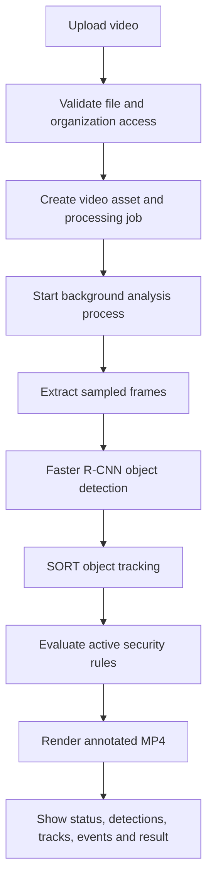

# AEGISVISION

**AI-Assisted Video Analytics & Security Operations Platform**

AEGISVISION is a Django and React application for managing security workspaces, video sources, recorded-video analysis, object detection and tracking, rule-based event detection, and security operations workflows. It supports Persian and English interfaces, including RTL and LTR layouts.

> **Current project package:** `1.5.0` — Live Camera Intelligence  
> **Repository:** [AliSolhjoo/AEGISVISION](https://github.com/AliSolhjoo/AEGISVISION)  
> **Persian release guide:** [`README_FA.md`](README_FA.md)

---

## Contents

- [Overview](#overview)
- [Main capabilities](#main-capabilities)
- [Video-analysis workflow](#video-analysis-workflow)
- [Live camera workflow](#live-camera-workflow)
- [Architecture](#architecture)
- [Technology stack](#technology-stack)
- [Requirements](#requirements)
- [Local installation](#local-installation)
- [Running the application](#running-the-application)
- [First-use guide](#first-use-guide)
- [Frontend pages](#frontend-pages)
- [API overview](#api-overview)
- [Database and migrations](#database-and-migrations)
- [Configuration reference](#configuration-reference)
- [Security considerations](#security-considerations)
- [Current limitations](#current-limitations)
- [Validation and tests](#validation-and-tests)
- [GitHub publication checklist](#github-publication-checklist)
- [License](#license)

## Overview

AEGISVISION combines video-analysis tools with security-event operations in a single organization-aware workspace. Its current implementation includes two main analysis paths:

1. **Recorded video:** upload a supported video, then run a background workflow that extracts frames, detects objects, tracks detections, evaluates configured security rules, and renders an annotated MP4 result.
2. **Network cameras:** register an RTSP/RTSPS source, test its connection, and start server-side live analysis through a persistent worker manager.

The application also provides organization membership and roles, camera and video inventories, analysis history, event review, SOC dashboards, and bilingual user interfaces.

AEGISVISION is an evolving software project. The supplied package is a development release, not a production deployment bundle. See [Security considerations](#security-considerations) and [Current limitations](#current-limitations) before deploying it in a real environment.

## Main capabilities

### 1. Authentication and workspace access

- Custom email-based Django user model.
- User registration, login, logout, refresh-token, and current-user endpoints.
- Password-change and password-reset request/confirmation endpoints.
- JWT access and refresh tokens through Django REST Framework SimpleJWT.
- Organization workspaces with membership records and invitation/acceptance flows.
- Organization membership roles currently defined in the backend:
  - `owner`
  - `admin`
  - `operator`
  - `analyst`
  - `viewer`
- Organization-scoped access checks for cameras, videos, and security operations.

### 2. Camera management

- Register and manage camera sources inside an organization.
- RTSP and RTSPS source types for server-side camera processing.
- Camera name, unique code, location, operational description, status, AI sampling FPS, and detection-confidence threshold.
- Connection-test endpoint before starting live analysis.
- Camera usernames and passwords are accepted separately from the stream URL and stored as encrypted credentials.
- Camera credential ciphertext is not returned by the API serializers.

The data model also contains a `browser` source type. However, the current server-side live-analysis worker is for RTSP/RTSPS network streams; browser camera capture is not connected to that worker.

### 3. Recorded-video library

- Upload and manage video assets within an organization.
- Store video metadata such as original filename, file size, content type, and SHA-256 digest.
- Queue a video for processing and inspect its processing status.
- Browse extracted frames and AI detection results.
- Re-run an analysis for an existing asset through the API.
- Play the generated annotated video when the output is ready.

The upload API currently accepts `.mp4`, `.mov`, `.avi`, `.mkv`, `.webm`, and `.m4v` files. The configured upload-size limit is 250 MB. The processing service also enforces a maximum duration of 20 minutes, a maximum of 300 sampled frames, and video-dimension safety checks.

### 4. AI object detection

- Frame-level object detection using a Faster R-CNN MobileNetV3 model from the PyTorch/Torchvision stack.
- Detection records include object class/label, confidence, and bounding-box information.
- Detection runs and their frame results are persisted for later review.
- Annotated frame images can be requested through the API.

The first model execution may need to download pretrained model weights. GPU acceleration depends on a compatible PyTorch, Torchvision, CUDA, and NVIDIA-driver installation; otherwise, processing can run on CPU with lower throughput.

### 5. Object tracking

- SORT-style multi-object tracking across sampled frames.
- Kalman-filter prediction for object bounding boxes.
- Hungarian assignment for frame-to-frame detection association.
- Track records and observations are stored and exposed through the API.
- Tracking metadata can be rendered into the exported video.

A track ID is a temporary tracking identifier within a run/session. It is **not** a verified person identity and does not provide cross-camera re-identification.

### 6. Rule-based security-event detection

The event engine can evaluate tracked objects against configured rules, including:

- **Zone intrusion:** detect an object entering a configured polygonal region.
- **Line crossing:** detect an object crossing a configured virtual line, with direction options.
- **Loitering:** detect an object remaining within a region longer than a configured duration.

Rules can be scoped to a video or camera. The example analytics configuration is located at `backend/analytics_configs/example_rules.json`. Event evaluation is performed after tracking for recorded videos when applicable active rules exist. Live-camera rules are evaluated by the live rule engine.

### 7. Security Operations Center (SOC)

The SOC module provides operational views and workflows for security events, including:

- SOC dashboard and event queue.
- Event severity and status handling.
- Assignment to responsible users.
- Investigation notes and activity/audit history.
- CSV export of SOC events.
- Role-aware interface behavior and Persian/English localization.

### 8. Live Camera Intelligence

The live-camera module adds:

- RTSP/RTSPS network-camera registration.
- Encrypted camera credentials.
- Camera connection testing and stream-health state.
- A persistent background worker manager.
- Object detection and SORT tracking on sampled live frames.
- Annotated JPEG snapshots with detection boxes, classes, confidence values, and track IDs.
- Live Zone Intrusion, Line Crossing, and Loitering rules.
- Live security events and event-status updates.
- Worker heartbeat, connection state, frame counters, resolution, and processing-FPS information.
- Automatic reconnect attempts after temporary stream failures.

The current live-analysis settings permit `target_fps` values from 1 to 10, with a model default of 2 FPS and a default confidence threshold of 0.55. These values control AI sampling, not the camera's native frame rate or browser playback rate.

### 9. Bilingual interface

- English and Persian translations.
- RTL layout for Persian and LTR layout for English.
- Language preference persisted in browser local storage.
- React-based dashboards, tables, forms, status indicators, notifications, and charts.

## Video-analysis workflow

The recorded-video workflow is designed to run outside the upload request so that video processing does not block the browser while the full pipeline is executing.



The status API exposes phases such as `queued`, `extracting`, `detecting`, `tracking`, `event_analysis`, `rendering`, `completed`, and `failed`. The workflow stores processing state and error details so the frontend can display progress and the final result.

Current defaults and validation limits in the upload workflow:

| Setting | Current behavior |
|---|---|
| Maximum upload size | 250 MB |
| Accepted extensions | `.mp4`, `.mov`, `.avi`, `.mkv`, `.webm`, `.m4v` |
| Default frame interval | 1 second |
| Allowed frame interval | 1–60 seconds |
| Default maximum sampled frames | 300 |
| Allowed maximum sampled frames | 2–300 |
| Maximum video duration | 20 minutes |
| Output | Annotated MP4 |

The upload endpoint starts the background analysis process automatically. The older extraction/detection/tracking management commands remain in the codebase for operational and development use; they are not a substitute for checking the automatic workflow status for a specific uploaded asset.

## Live camera workflow

1. Create or select an organization.
2. Open **Cameras** and register an RTSP or RTSPS source.
3. Enter the stream URL and, when required, the camera username/password in their separate fields. Do not embed credentials in the URL.
4. Configure the AI sampling FPS and confidence threshold. Start with a low FPS on a single camera.
5. Open **Live Cameras** and run **Test connection**.
6. Start live analysis. The worker manager consumes the start request and connects to the network stream.
7. Configure the live analytics rules and monitor snapshots, worker status, and security events.
8. Stop the camera session when it is no longer required.

For an initial test, use one reachable 720p camera at 1–2 AI FPS. Increase the number of cameras or sampling FPS only after measuring CPU/GPU use, memory, temperature, and actual processing throughput on the target machine.

## Architecture

```text
AEGISVISION/
├── backend/
│   ├── config/                     # Django settings, URL routing, ASGI/WSGI
│   ├── apps/
│   │   ├── accounts/               # Custom user model and authentication APIs
│   │   └── organizations/          # Workspaces, membership, permissions and SOC
│   │       ├── cameras/            # Cameras, videos, detection, tracking, events
│   │       └── migrations/         # Database schema migrations
│   ├── analytics_configs/         # Example event-rule configuration
│   ├── manage.py
│   └── media/                      # Runtime uploads and generated media (not source)
├── frontend/
│   ├── src/
│   │   ├── components/            # Shared UI components
│   │   ├── context/               # Authentication and organization contexts
│   │   ├── lib/                   # API client, types and formatting
│   │   ├── pages/                 # Application screens
│   │   ├── i18n.tsx               # Persian/English translation layer
│   │   └── App.tsx                # Frontend routes
│   ├── package.json
│   └── vite.config.ts
├── requirements.txt
├── Start_AEGISVISION.bat          # Windows development launcher
├── README.md
└── README_FA.md                   # Persian release-specific guide
```

### Backend modules

| Module | Responsibility |
|---|---|
| `apps.accounts` | Custom user model, registration, JWT authentication, password flows |
| `apps.organizations` | Organizations, memberships, permissions, invitations and administration |
| `cameras.models` | Camera inventory and encrypted camera credentials |
| `video_models` / `video_services` | Video assets, processing jobs and frame extraction |
| `detection_models` / `detection_services` | Detection runs and object detections |
| `tracking_models` / `tracking_services` | Tracking runs, tracks and observations |
| `event_models` / `event_services` | Analytics rules, security events and event activity |
| `live_models` / `live_stream_services` | Live state, worker health, RTSP processing and snapshots |
| `live_rule_engine` | Live zone, line-crossing and loitering evaluation |
| `soc_views` | SOC dashboard, queue, assignment and export endpoints |

## Technology stack

### Backend

- Python 3.12+
- Django 6.1.3
- Django REST Framework 3.18.1
- Django REST Framework SimpleJWT
- `django-filter`
- `django-cors-headers`
- OpenCV (`opencv-python`)
- PyTorch and Torchvision
- Cryptography / Fernet for camera credentials
- SQLite as the default database in the supplied settings

`psycopg` and `celery[redis]` are listed in `requirements.txt`, but the supplied default Django configuration uses SQLite and does not configure a PostgreSQL/Celery production deployment. Do not assume those services are active merely because their Python packages are installed.

### Frontend

- React 18
- TypeScript 5
- Vite 6
- React Router 6
- Recharts
- Lucide React

## Requirements

For local development, prepare:

- Python 3.12 or newer.
- Node.js LTS and npm.
- Git.
- A supported Windows, Linux, or macOS development environment.
- Enough memory and disk space for PyTorch, video frames, and generated MP4 files.
- A compatible GPU and CUDA stack only if GPU acceleration is required.
- Network access to each RTSP/RTSPS camera from the computer running the backend and live worker.

**Dependency note:** the supplied `requirements.txt` does not currently list SciPy, while the SORT tracker imports `scipy.optimize.linear_sum_assignment`. Install SciPy separately using `python -m pip install scipy`, or add a compatible SciPy version to `requirements.txt` before preparing a clean deployment.

For GPU use, install a PyTorch/Torchvision pair that matches the target Python version, operating system, CUDA runtime, and NVIDIA driver. Use the official PyTorch installation selector rather than assuming that every machine supports the same CUDA build.

## Local installation

### 1. Get the source

```bash
git clone https://github.com/AliSolhjoo/AEGISVISION.git
cd AEGISVISION
```

If the repository is still empty, upload the cleaned project files first, or use the local project directory that contains the source.

### 2. Create and activate a Python virtual environment

**Windows CMD:**

```cmd
python -m venv .venv
.venv\Scripts\activate
```

**PowerShell:**

```powershell
python -m venv .venv
.\.venv\Scripts\Activate.ps1
```

**Linux / macOS:**

```bash
python3 -m venv .venv
source .venv/bin/activate
```

### 3. Install Python dependencies

```bash
python -m pip install --upgrade pip
python -m pip install -r requirements.txt
python -m pip install scipy
```

If you need CUDA acceleration, confirm or replace the automatically resolved Torch/Torchvision builds with the compatible versions recommended by the PyTorch installation selector.

### 4. Configure local environment variables

The backend looks for a `.env` file in the project root (the same level as `backend/`), not inside `backend/`. The supplied `.env.auth.example` is a reference file for authentication-related variables. Copy it to `.env` and replace placeholders as appropriate:

```bash
# Run from the AEGISVISION project root
cp .env.auth.example .env
```

On Windows CMD:

```cmd
copy .env.auth.example .env
```

The current `settings.py` reads these environment variables:

| Variable | Purpose |
|---|---|
| `JWT_SIGNING_KEY` | Independent signing key for JWTs; strongly recommended |
| `FRONTEND_URL` | Base URL used to build password-reset links |
| `DEFAULT_FROM_EMAIL` | Sender address used by the password-reset flow |

The sample file also documents SMTP variables. The current `settings.py` does not map all `EMAIL_*` variables from the environment into Django's email settings, so configure and verify the Django email backend explicitly before relying on real SMTP delivery. The console email backend should be used only after it is correctly configured for local development.

**Important:** the supplied `settings.py` currently contains a hard-coded development `SECRET_KEY` and does not load `SECRET_KEY` from the environment. Replace that implementation with a generated, environment-backed secret before public/production deployment; see [Security considerations](#security-considerations). Do not simply rotate it on an existing database that contains encrypted camera credentials without planning a controlled re-encryption step.

### 5. Install frontend dependencies

```bash
cd frontend
npm install
```

The Vite development server proxies `/api` requests to `http://127.0.0.1:8000` by default. Leave `VITE_API_BASE_URL` empty for this local setup. A sample frontend environment file is provided at `frontend/.env.example`.

### 6. Apply database migrations

Open a new terminal, activate the Python virtual environment, and run:

```bash
cd backend
python manage.py showmigrations
python manage.py migrate
python manage.py check
```

The current organization app migration chain includes `0001` through `0008`; the live-camera feature is introduced by `organizations.0008_live_camera_intelligence`, which depends on `0007_soc_operations`.

Create an administrator account when needed:

```bash
python manage.py createsuperuser
```

## Running the application

### Option A — Windows launcher

From the project root, run:

```cmd
Start_AEGISVISION.bat
```

The launcher checks the project paths and installed tools, installs frontend dependencies if `frontend/node_modules` is missing, applies migrations, runs `manage.py check`, and starts:

- Django backend at `http://127.0.0.1:8000`
- Live-camera worker manager in a minimized process
- Vite frontend at `http://localhost:5173`

Keep the opened server and worker processes running while using the application. The live-worker log is written to `backend/logs/live_camera_worker.log`.

### Option B — Manual startup (all platforms)

Start each component in its own terminal.

**Terminal 1 — Django backend:**

```bash
cd backend
python manage.py migrate
python manage.py check
python manage.py runserver 127.0.0.1:8000
```

**Terminal 2 — live-camera worker manager:**

```bash
cd backend
python manage.py run_live_camera_workers
```

This process is needed for server-side RTSP/RTSPS live analysis. Keep it running while live camera processing is expected. It is not required merely to browse the frontend or inspect completed video-analysis results.

**Terminal 3 — React frontend:**

```bash
cd frontend
npm run dev
```

Open `http://localhost:5173` in the browser.

### Useful development commands

Run backend checks:

```bash
cd backend
python manage.py check
python manage.py showmigrations
```

Run the backend test suite:

```bash
python manage.py test
```

Run selected camera-intelligence tests:

```bash
python manage.py test apps.organizations.cameras.test_live_camera_intelligence
python manage.py test apps.organizations.cameras.test_soc_operations
python manage.py test apps.organizations.cameras.test_sort_tracker_v1
```

Frontend type-check and production build:

```bash
cd frontend
npm run typecheck
npm run build
```

## First-use guide

1. Start the backend and frontend.
2. Register an account or sign in with an existing account.
3. Create or select an organization workspace.
4. Add team members and assign appropriate organization roles.
5. For recorded-video analysis, open **Videos** or **Automatic Analysis**, upload a supported video, and follow its processing status.
6. Review extracted frames, detections, tracking results, and the annotated video after the pipeline completes.
7. Configure event rules for the relevant video or camera to generate rule-based security events.
8. Open **Events** or **SOC** to review, assign, investigate, and export events.
9. For live analysis, register an RTSP/RTSPS camera, test the connection, then start it from **Live Cameras**.

Do not use a camera or recorded video unless you have the required authorization and legal basis to process it.

## Frontend pages

The current React router defines these application routes:

| Route | Page |
|---|---|
| `/login` | Sign in |
| `/reset-password` | Password reset |
| `/` | Overview |
| `/monitoring` | Monitoring |
| `/cameras` | Camera management |
| `/live-cameras` | Live Camera Intelligence |
| `/videos` | Video library |
| `/detections` | Automatic video analysis |
| `/detection-runs` | Detection runs |
| `/tracking` | Object tracking |
| `/organizations` | Organization workspaces |
| `/team` | Team and access |
| `/events` | Events and alerts |
| `/soc` | Security Operations Center |
| `/settings` | Account/application settings |
| `/help` | Help center |

## API overview

All API endpoints are served by the Django backend. Most application endpoints require authentication. JWT access tokens are sent using the `Authorization: Bearer <access-token>` header by the frontend API client.

### Authentication — `/api/auth/`

| Method | Endpoint | Purpose |
|---|---|---|
| POST | `/api/auth/register/` | Register a user |
| POST | `/api/auth/token/` | Obtain JWT tokens |
| POST | `/api/auth/token/refresh/` | Refresh access token |
| POST | `/api/auth/logout/` | Log out / blacklist refresh token |
| GET | `/api/auth/me/` | Current-user profile |
| POST | `/api/auth/change-password/` | Change password |
| POST | `/api/auth/password-reset/` | Request password reset |
| POST | `/api/auth/password-reset/confirm/` | Confirm password reset |

Configured token lifetimes in the supplied settings are 10 minutes for access tokens and 7 days for refresh tokens, with refresh rotation and blacklist support enabled.

### Recorded-video analysis — `/api/video-analysis/`

| Method | Endpoint | Purpose |
|---|---|---|
| POST | `/api/video-analysis/upload/` | Upload a video and start its background analysis workflow |
| POST | `/api/video-analysis/assets/{asset_id}/start/` | Start or resume analysis for an existing asset |
| GET | `/api/video-analysis/assets/{asset_id}/status/` | Read processing status and progress |
| GET | `/api/video-analysis/assets/{asset_id}/result/` | Retrieve the generated annotated MP4 when ready |

### Organization and camera APIs — `/api/organizations/`

The organization API includes workspace and membership management, camera inventory, video assets and frames, detection runs, tracking runs and tracks, event rules, security events, live-camera state, and SOC operations.

Representative route patterns include:

```text
/api/organizations/
/api/organizations/{organization_id}/
/api/organizations/{organization_id}/members/
/api/organizations/{organization_id}/cameras/
/api/organizations/{organization_id}/cameras/{camera_id}/test-connection/
/api/organizations/{organization_id}/cameras/{camera_id}/live/
/api/organizations/{organization_id}/cameras/{camera_id}/live/start/
/api/organizations/{organization_id}/cameras/{camera_id}/live/stop/
/api/organizations/{organization_id}/cameras/{camera_id}/live/snapshot/
/api/organizations/{organization_id}/cameras/{camera_id}/event-rules/
/api/organizations/{organization_id}/videos/
/api/organizations/{organization_id}/events/
/api/organizations/{organization_id}/soc/dashboard/
/api/organizations/{organization_id}/soc/events/
/api/organizations/{organization_id}/soc/events/export.csv
```

The Django administration site is available at `/admin/`. The browsable REST Framework session-authentication routes are mounted at `/api-auth/`.

For the authoritative route definitions, see `backend/config/urls.py` and `backend/apps/organizations/urls.py`.

## Database and migrations

- The supplied development configuration uses SQLite at `backend/db.sqlite3`.
- Database schema changes are managed by Django migrations.
- Do not delete an existing database to resolve a migration problem.
- Do not use `migrate --fake` as a routine repair step.
- Back up the database and media before upgrading an existing installation.
- Keep the original `SECRET_KEY` available when an existing database contains camera credentials encrypted with that key. A planned key rotation must decrypt and re-encrypt those credentials before the old key is retired.

To inspect migration status and apply pending migrations:

```bash
cd backend
python manage.py showmigrations
python manage.py migrate
```

## Configuration reference

| File | Purpose |
|---|---|
| `requirements.txt` | Python dependencies |
| `backend/config/settings.py` | Django configuration, authentication, database and security settings |
| `backend/config/urls.py` | Root API route registration |
| `.env.auth.example` | Authentication-related environment-variable example |
| `frontend/.env.example` | Optional Vite API base URL |
| `frontend/vite.config.ts` | Vite server and local `/api` proxy |
| `Start_AEGISVISION.bat` | Windows development launcher |
| `backend/analytics_configs/example_rules.json` | Example analytics-rule configuration |
| `VALIDATION_RESULTS_FA.txt` | Validation summary shipped with the package |
| `INSTALL_WINDOWS.txt` | Short Windows installation guide |

## Security considerations

> **Do not deploy the supplied settings unchanged to a public or production server.** The current source is configured for local development.

The supplied archive contains the following security items that must be addressed before a public production deployment:

1. **Development Django secret:** `backend/config/settings.py` contains a hard-coded `django-insecure` development `SECRET_KEY`. Treat this key as exposed. Replace it with a unique, generated, environment-backed secret before deployment. Do not commit the replacement secret or a real `.env` file.
2. **Debug mode:** `DEBUG` is currently `True`, and `ALLOWED_HOSTS` is empty. Configure `DEBUG=False`, explicit allowed hosts, HTTPS, secure cookies, CSRF trusted origins, and deployment-appropriate static/media handling before production.
3. **Camera-credential encryption:** `camera_secrets.py` derives its Fernet encryption key from Django `SECRET_KEY`. Changing `SECRET_KEY` without re-encrypting existing camera credentials makes the stored ciphertext undecryptable. Keep the key stable or perform a controlled migration.
4. **JWT signing:** set a strong, independent `JWT_SIGNING_KEY`; do not rely on the fallback to Django `SECRET_KEY` for production.
5. **Email configuration:** password-reset endpoints exist, but the sample SMTP variables need to be connected to Django's actual email settings and tested before relying on real password-reset delivery.
6. **Secrets and local data:** never commit `.env`, API credentials, camera passwords, production database files, or private camera/video content.
7. **Network exposure:** restrict database, worker, admin, and camera-network access. Use HTTPS and appropriate firewall rules. Do not expose RTSP streams directly to the public internet.
8. **Privacy and authorization:** process cameras and recordings only with proper authorization, consent where required, retention policies, and access controls.

The current camera-credential design encrypts the username/password pair before database storage and avoids returning the ciphertext through normal camera API responses. This is useful protection, but it does not replace secret management, transport security, database access controls, or a production security review.

## Current limitations

The following limitations are explicit in the current release documentation and code:

- Server-side live AI processing supports **RTSP and RTSPS** sources. Browser-camera capture is not connected to the live worker.
- The live preview is based on periodically refreshed **JPEG snapshots**. It is not a WebRTC or HLS low-latency stream and does not promise 25/30 FPS playback.
- `target_fps` is the AI sampling/inference target, not the native camera FPS or guaranteed display FPS.
- Continuous RTSP recording and long-term recording archive management are not implemented in this release.
- PTZ camera control is not implemented.
- Cross-camera person re-identification is not implemented.
- Track IDs are local tracking identifiers, not verified identities.
- Multi-camera structure exists, but model inference is serialized by a shared worker-manager lock in the current implementation. Real capacity depends on the target hardware and stream settings.
- A working GPU path depends on compatible PyTorch/Torchvision/CUDA/driver versions.
- The supplied configuration is not a production deployment configuration.

## Validation and tests

The package includes `VALIDATION_RESULTS_FA.txt`, which reports the following checks for the packaged release:

**Reported as passed:**

- Python `compileall` for backend apps, Django config, and `manage.py`.
- 23 pure-logic tests across SORT tracking, live-camera intelligence, and video analytics.
- TypeScript/TSX syntax transpilation for 30 files with no syntax diagnostics.
- Translation-key and CSS structural checks for the reviewed live-camera pages.
- Review of the additive `organizations.0008_live_camera_intelligence` migration.

**Not fully verified in the package validation environment:**

- Django system checks and full Django integration tests were not run there because Django was not installed in that validation environment.
- The full frontend production build did not complete there because some frontend type-package directories were incomplete. Reinstall dependencies and rerun `npm run build` on the target machine.
- Actual RTSP connectivity, camera decoding, CUDA availability, and live inference throughput require the target network, camera, drivers, and hardware.

After installing dependencies, rerun the checks in [Running the application](#running-the-application) before treating a build as validated. A successful syntax check is not the same as a complete end-to-end test.

## GitHub publication checklist

Before pushing the project to a public GitHub repository, inspect the working tree and ensure that only source code, required configuration examples, migrations, documentation, and intentional public assets are staged.

The supplied ZIP contains local/development artifacts in addition to source code, including:

- `backend/db.sqlite3` — a local SQLite database.
- `backend/media/` — uploaded videos, extracted frames, and generated media.
- `frontend/node_modules/` — installed third-party packages.
- Python `__pycache__/` and compiled bytecode.
- A `.git/` directory from the packaged working folder.
- Historical `*.aegis_backup_*` source backups.

The current `.gitignore` already excludes the local database, backend media/logs, frontend `node_modules`, Python cache files, and environment files. However, it does not currently exclude all historical backup files or the generated `backend/tracking_exports/` directory. Review and extend `.gitignore` before staging. A useful additional set of patterns is:

```gitignore
# Additional local/generated artifacts
*.sqlite3
backend/tracking_exports/
*.aegis_backup_*
*.mp4
*.log
```

Only ignore video extensions if the repository is not intentionally shipping a small, licensed public demo clip. Keep real camera footage, private snapshots, and user-generated media out of the public repository.

Also:

- Remove the ZIP's nested `.git/` directory when preparing a fresh local checkout; use the repository's own Git metadata.
- Review `git status --short` before every commit.
- Inspect staged files with `git diff --cached --stat` and `git diff --cached`.
- Confirm `.env` and real credentials are not staged.
- Remove obsolete backup copies after verifying that the active source files are correct.
- Do not upload a runtime database or private media merely to make the repository look populated.
- Add a `LICENSE` only after choosing the license terms you actually want to grant.

A public GitHub repository is not automatically an open-source-licensed project. See [License](#license).

## License

No `LICENSE` file was present in the supplied archive. Until a license is added, do not assume that this repository grants permission to reuse, redistribute, or commercially deploy the code. Add a license only after deciding on the intended terms and confirming that third-party dependencies and assets are compatible with that choice.

---

**AEGISVISION 1.5.0**  
**Main feature set:** Automatic Video Analysis · Object Detection · SORT Tracking · Security Events · SOC · RTSP/RTSPS Live Camera Intelligence  
**Interface:** Persian / English · RTL / LTR
